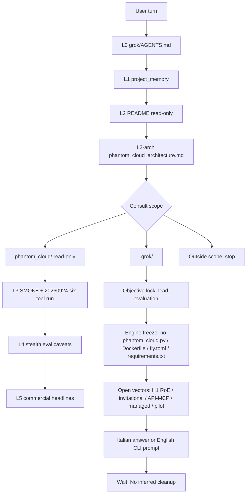

UPDATED: 2026-10-01T12:24Z
VERSION: fly-163 / git-6e95b31 / ingest-2026-09-28T14:35Z
PROJECT: phantom_cloud

# Agent process diagram

Session agent only. Not the device CLI. Not a production deploy.

Branch split:

- This session writes only under `grok/` unless the same turn names a path.
- Device Grok Build 4.7 on Drive `1msmuBIu_28tNkjBxhKQ6S-x9DzfZjpO5` is the operative CLI. It does not load this L0 stack.
- Fly `phantom-cloud-engine` / `fra` / `https://phantom-cloud-engine.fly.dev` is the production machine. This diagram does not deploy it.

Tool surface: `navigate`, `get_snapshot` (html|ax), `click`, `type`, `evaluate`, `wait`.

Accepted smoke: `runs/prod_postdeploy_20260924T153949Z`. SwiftShader is not solved.
